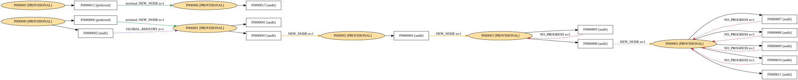
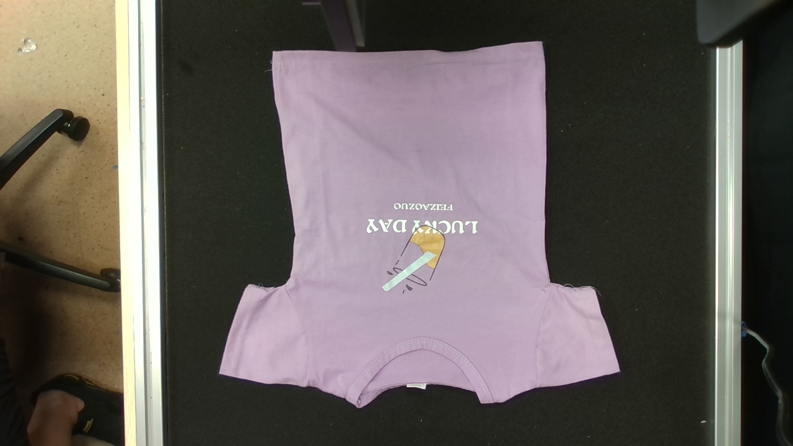
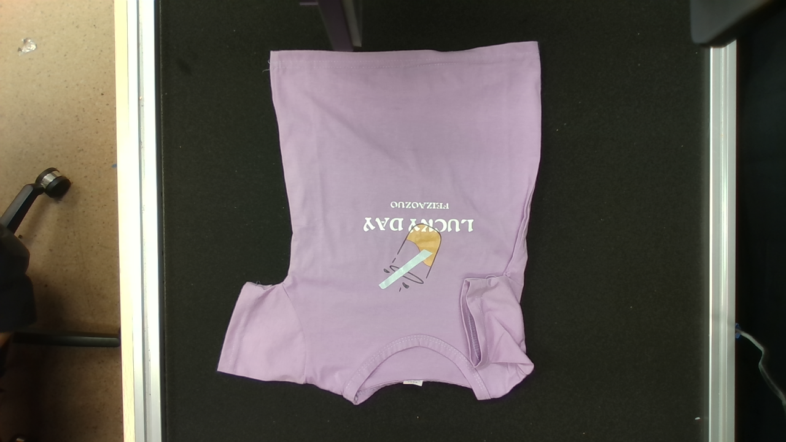
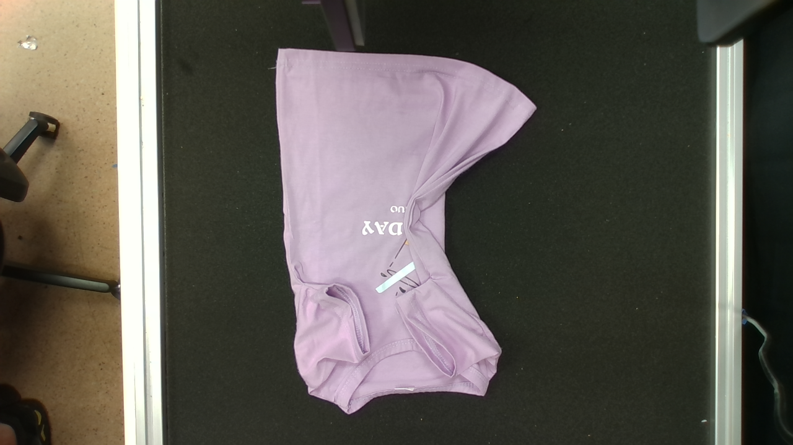
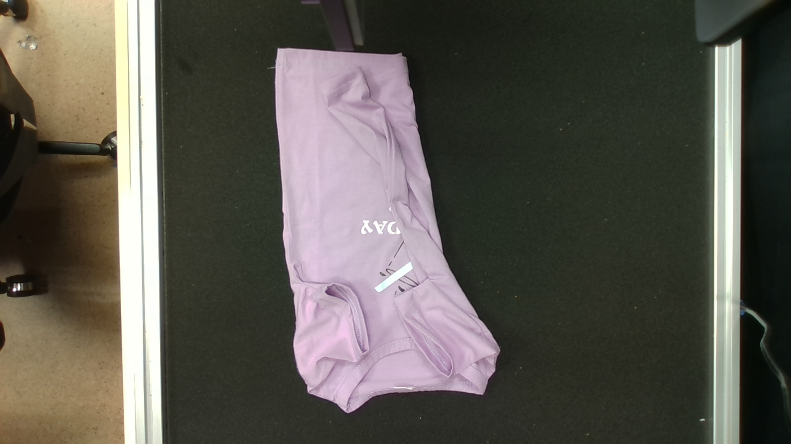

# 真实运行对照 Demo

这里展示的是 **2026-10-17 已实际执行的记录**，不是合成数据，也不是重新调用模型生成的
示例。可视化由原始 `growth_000096.json` 渲染；`snapshot.json` 是该文件的逐字节副本，
原 SHA256 保存在旁边。这个经验图包含失败和无进展，**不代表整件衣服已经成功折叠**。

## 打开现成结果

[下载现成 Demo ZIP](https://github.com/WhiteEurya/clothAgent_real/releases/download/graph-demo-20261017/graph-demo-20261017.zip)，
解压后双击 `graph_demo/index.html`。
不需要 Python、机器人、模型账号或 409 MiB 数据包。可拖动/缩放图，点击状态查看原始观测。
完整的 State → Action → Outcome 展示见 [graph.svg](graph.svg)，包括尚无已确认结果的动作。
交互画布为紧凑状态图；完整动作计数和拓扑以 SVG、JSON 及自动比较为准。



## 除了 graph，可以核对什么

| 对照项 | 真实记录 | 能验证的内容 |
|---|---|---|
| 节点 RGB 观测 | [images/](images/)，7 个节点原图 | 状态对应的实际衣物外观；哈希可检查数据是否一致 |
| 动作前后原图、相机/关节/TCP 状态 | 两个 case 的 `before/`、`after/` | 同一动作前后使用了哪张图、什么坐标/标定与机器人状态 |
| 深度/世界坐标数组 | 409 MiB 数据包中的 `world_xyz_mm.npy` 等 | 离线几何计算输入；本 Demo 不重复装入这些大数组 |
| 模型输入和原始回答 | `execution/planner/prompt.txt`、`answer.txt`、`result.json` | 当时实际请求、回答及调用结果；不是新编写的标准答案 |
| 原始动作与最终派发动作 | `execution/motion.py`、`effective_motion.py`、`dispatch_intent.json` | 宿主处理前后究竟执行了什么 |
| 实际规划与执行反馈 | `native_plan.json`、`execution_events.json`、`execution.json` | 规划分段、执行事件、是否实际执行、完成命令数 |
| 夹爪反馈 | `execution/gripper_*.json` | 开度、错误码及完成判断；不能单独证明衣服折叠有进展 |
| 视觉匹配及状态转移 | `outcome_match.json`、`transition.json` | 当时模型返回的匹配及实际记录的转移，不是人工真值标注 |
| 累计统计 | [expected.json](expected.json) | 节点/动作/转移、实机尝试、自环与未匹配结果的计数 |

所有复制的原始文件均在 [actual_cases.json](actual_cases.json) 中记录来源路径、大小和
SHA256。`transition.json` 是原始图中对应记录的摘录；其他证据副本保持原始字节。
SVG、HTML 和此说明是基于这些实跑记录生成的展示，不是新的物理运行。

## 案例 A：实际执行后观察到状态变化

来源：`policy_replay_20261017T022854003479Z/episode_0001/step_0000`。

- 记录：`A0000000 / F0000000 / T0000000`，`P000000 → P000001`，`NEW_NODE`。
- [执行反馈](cases/observed_progress/execution.json)：`EXECUTED`，`physical_execution=true`，完成 **6** 条命令。
- [匹配结果](cases/observed_progress/outcome_match.json)：原节点不匹配，后续记录新节点。
- [闭爪反馈](cases/observed_progress/execution/gripper_003.json)：最终 `position_pulse=12`、`error_code=0`。
- 这表示该步记录了执行及状态变化，不表示整个折叠任务完成。

| 动作前真实图 | 动作后真实图 |
|---|---|
|  |  |

## 案例 B：执行成功返回，但图状态没有进展

来源：`graph_collect_20261017_112855/episode_0001/step_0003`。

- 记录：`A0000005 / F0000005 / T0000004`，`P000003 → P000003`，`NO_PROGRESS`。
- [执行反馈](cases/observed_self_loop/execution.json)：`EXECUTED`，`physical_execution=true`，完成 **8** 条命令。
- [匹配结果](cases/observed_self_loop/outcome_match.json)：`MATCH P000003`，模型置信度 **0.87**。
- [闭爪反馈](cases/observed_self_loop/execution/gripper_003.json)：最终 `position_pulse=11`、`error_code=0`。
- 此例用于检查系统是否错误地把“SDK 命令执行完成”当作“任务有进展”。原记录没有证明
  无进展一定由空抓导致，因此不把它标注成确定的空抓样例。

| 动作前真实图 | 动作后真实图 |
|---|---|
|  |  |

## 自动对照

在仓库根目录执行。只检查小 Demo，无需下载完整证据包：

```bash
python scripts/verify_demo_evidence.py --demo-only
```

预期 `PASS`，检查 43 个证据副本；8 个大数组明确跳过，不算已验证。
按 [复现说明](../../reproduction/README.md) 恢复数据后，检查全部 51 项原始证据：

```bash
python scripts/verify_demo_evidence.py --root /path/to/clothAgent_real
```

对照同一快照的离线 dry-run 输出：

```bash
python scripts/compare_graph_demo.py --snapshot /path/to/dry_run/latest.json
```

预期 `PASS`，7 个状态、14 个动作、11 条已观测转移。脚本验证冻结文件哈希，比较完整
内容，只忽略顶层快照版本号和 `/runs/` 前的机器目录。不同节点、动作、转移或结果
不会因为计数相同而通过。已用现有离线结果 `growth_000098.json` 验证通过。

累计实跑统计：**13 次 physical actions、11 个转移、5 个无进展自环、2 次未匹配尝试**。
graph-policy actions 为 **0**；不能据此宣称 graph-only success。

这个严格比较用于“恢复同一数据并离线复现”。重新调用模型或重新操作真实衣服时，
图片、时间、位置及模型回答可能变化，不能要求逐字节相同；应依据真实前后观测和
执行反馈评估结果。这里没有提供已验证整件折叠成功、恢复策略必然成功等不存在的真值。
