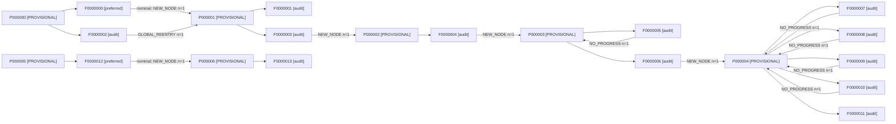

# Online experience graph

State → Action → Outcome State. Orange states remain provisional.
Green: preferred nominal; orange: alternative; red: no progress; purple: re-entry; gray: excluded seed evidence. Counts exclude seed priors.



```json
{
  "total_physical_actions": 13,
  "graph_policy_actions": 0,
  "gpt_frontier_actions": 13,
  "recovery_actions": 0,
  "local_outcome_matches": 5,
  "global_reentries": 1,
  "new_provisional_nodes": 7,
  "no_progress_self_loops": 5,
  "multi_outcome_actions": 0,
  "additional_observed_outcomes": 0,
  "current_nodes": 7,
  "current_transitions": 11,
  "graph_action_ratio": 0.0,
  "new_node_rate": 0.38461538461538464,
  "new_node_rate_definition": "post-action new nodes / all physical attempts; initial node discovery excluded",
  "observed_outcome_counts": {
    "F0000000": {
      "P000001": 1
    },
    "F0000001": {},
    "F0000002": {
      "P000001": 1
    },
    "F0000003": {
      "P000002": 1
    },
    "F0000004": {
      "P000003": 1
    },
    "F0000005": {
      "P000003": 1
    },
    "F0000006": {
      "P000004": 1
    },
    "F0000007": {
      "P000004": 1
    },
    "F0000008": {
      "P000004": 1
    },
    "F0000009": {
      "P000004": 1
    },
    "F0000010": {
      "P000004": 1
    },
    "F0000011": {},
    "F0000012": {
      "P000006": 1
    },
    "F0000013": {}
  },
  "unmatched_physical_attempts": 2
}
```
